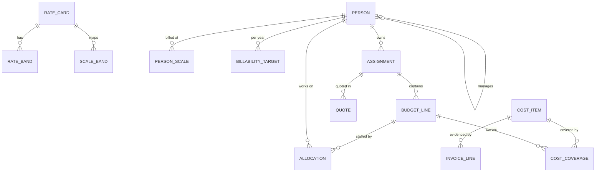

# Grip: basisbeschrijving

> Dit is het document waarmee grip op 2026-10-08 begon, ongewijzigd bewaard. [domein.md](domein.md) nam het domein, de rekenregels en de acceptatiecriteria over. Waar grip afwijkt, gaan de [besluiten](adr/README.md) voor, onder meer over de stack (0002), de rollen (0009), de salarisschaal (0014) en de tarievenkaart per periode (0027). De startprompt in sectie 14 noemt het bestand bij zijn oorspronkelijke naam.

Hoe gebruik je dit bestand: deel het met wie Grip 2.0 bouwt. Sectie 14 is de startprompt om in een coding agent te plakken; secties 1 t/m 13 zijn de specificatie waar die prompt naar verwijst. Secties 1 t/m 13 volgen een vast sjabloon om een Grist-document om te zetten naar een applicatie, zodat een volgende omzetting dezelfde koppen kan hergebruiken. Alle opdrachtnamen, bedragen en tarieven hierin zijn fictief.

## 1. Context

Grip is een Grist-document (La Suite numérique) waarmee we opdrachten plannen en volgen: de begroting per opdracht, wie erop werkt tegen welk tarief, externe kosten en welke begroting die dekt, en een declarabiliteits-KPI per persoon. Grip 2.0 vervangt het document door een webapplicatie op Node.js.

## 2. Problemen die we oplossen

1. **Delen is alles of niets.** Alles staat in één document. Opdrachteigenaren, teamleden en managers hebben elk een ander beeld nodig, en schaal- en KPI-gegevens moeten afgeschermd blijven.
2. **Schaal is geen data.** De schaal van iemand staat in vrije tekst ("Schaal 11, maar rekent met 12"), en begrotingsregels verstoppen rol, FTE, schaal en startdatum in hun omschrijving ("Developer #2 (vanaf Q2, schaal 10/11)"). Er valt niet mee te rekenen of op te controleren.
3. **Maar één jaar.** Tarieven verschillen per jaar, maar het document heeft één tarieventabel, en opdrachten zijn per jaar geknipt ("Opdracht Alfa 2026"). Inzet of een opdracht die over 31 december loopt, is niet te prijzen of te rapporteren.
4. **De offerte is handwerk.** De begroting is de basis voor de offerte, maar die maken gebeurt buiten de tool.

## 3. Doelen en niet-doelen

Doelen:

- Eén gestructureerd datamodel dat de Grist-berekeningen behoudt en de huidige totalen tot op de euro reproduceert.
- Tarieven per jaar: elk bedrag wordt per maand berekend, tegen het tarief van het jaar van die maand.
- Toegang op basis van rollen, tot op veldniveau voor persoonsgegevens.
- Een offerte genereren uit de begroting.

Niet-doelen voor v1 (voorstel, bevestigen):

- Urenregistratie. Inzet blijft FTE per periode.
- Koppeling met financiële of factuursystemen. Facturen worden vastgelegd, niet verstuurd.

## 4. Begrippenlijst

UI-termen blijven Nederlands; code en schema gebruiken de Engelse naam.

| UI-term | Codenaam | Betekenis |
|---|---|---|
| Opdracht | `assignment` | Klantopdracht; de eenheid waarvoor een offerte wordt gemaakt |
| Begrotingsregel | `budget_line` | Eén regel van de begroting van een opdracht: een rol (personeel) of een vaste post (stelpost) |
| Begroot | `budgeted` | Gepland bedrag |
| Uitputting | `used` | Bedrag dat op een begrotingsregel is vastgelegd. Grist spelt zowel "Uitnutting" als "Uitputting"; gebruik "Uitputting" |
| Beschikbaar | `available` | `budgeted - used` |
| Team / Medewerker | `person` | Iemand die kan worden ingezet |
| Inzetschaal | `billing_scale` | De schaal waartegen iemand wordt gedeclareerd; kan afwijken van de salarisschaal |
| Salarisschaal | `salary_scale` | Werkelijke salarisschaal; gevoelig (zie sectie 8) |
| Categorie | `rate_category` | Tariefband A t/m E, elk voor twee schalen |
| Maandtarief | `monthly_rate` | Tarief per FTE per maand voor een categorie in een jaar |
| Tarievenleaflet | `rate_card` | Alle tarieven van één kalenderjaar |
| Inzet | `allocation` | Een persoon op een begrotingsregel, voor een periode, tegen een FTE-percentage |
| Kosten / Kostenpost | `cost_item` | Externe kosten, bijvoorbeeld een hostingcontract |
| Factuur | `invoice_line` | Een bedrag op een kostenpost, gerealiseerd of ingeschat |
| Realisatie / Inschatting | `actual` / `estimate` | Soort factuurregel |
| Kostendekking | `cost_coverage` | Welke begrotingsregel welk deel van een kostenpost dekt |
| Target KPI % declarabel | `billability_target` | Deel van iemands jaar dat declarabel moet zijn |
| Offerte | `quote` | Document dat uit de begroting van een opdracht wordt gegenereerd |
| Stand van zaken | `status_overview` | Dashboard per opdracht |

## 5. Datamodel



Afspraken: geld in hele centen (nooit floating point), FTE en percentages als exacte decimalen, datums als datum. Waarden gemarkeerd als *afgeleid* worden berekend met de regels uit sectie 6, niet opgeslagen, zodat ze niet kunnen afwijken. De enige uitzondering is een uitgegeven offerte: die is een bevroren momentopname.

### Tarieven

| Entiteit | Velden | Bron in Grist |
|---|---|---|
| `rate_card` | `year` (PK), `status` (`draft`, `active`, `closed`) | nieuw |
| `rate_band` | `year`, `category` (A t/m E), `monthly_rate`; uniek (`year`, `category`) | Tarievenleaflet |
| `scale_band` | `year`, `scale` (int), `category`; uniek (`year`, `scale`) | Tarievenleaflet |

Tarieven en de koppeling schaal → categorie zijn allebei per jaar, dus elk jaar kan een van beide veranderen.

### Mensen

| Entiteit | Velden | Bron in Grist |
|---|---|---|
| `person` | `name`, `manager_id` → person, `digi_gilde` (bool), `active` | Team |
| `person_scale` | `person_id`, `valid_from`, `valid_to` (optioneel), `billing_scale`, `salary_scale` (afgeschermd, zie open vraag 5) | Team.Notitie (vrije tekst) |
| `billability_target` | `person_id`, `year`, `target_pct` | Team / KPI per persoon |

### Opdrachten en begroting

| Entiteit | Velden | Bron in Grist |
|---|---|---|
| `assignment` | `name`, `status`, `quote_date`, `client_contact`, `owner_id` → person, `quoted_amount`, `start_date`, `end_date`, `notes` | Opdracht |
| `budget_line` | `assignment_id`, `description`, `kind` (`personnel`, `fixed`), `position` | Begroting |
| | personeel: `role`, `fte`, `rate_category`, `start_date`, `end_date`; `budgeted` *afgeleid* | uit de omschrijving gehaald |
| | vast: `amount`, `year`; `budgeted` = `amount` | Begroot |
| `allocation` | `person_id`, `budget_line_id` (alleen personeelsregels), `start_date`, `end_date`, `fte_pct` | Inzet |
| `quote` | `assignment_id`, `issued_at`, `issued_by`, `snapshot` (regels, tarieven en totalen zoals uitgegeven), `total` | nieuw |

### Kosten

| Entiteit | Velden | Bron in Grist |
|---|---|---|
| `cost_item` | `description`, `budgeted`; `forecast`, `covered` *afgeleid* | Kosten |
| `invoice_line` | `reference` (bijv. "HOST-26-01"), `description`, `kind` (`actual`, `estimate`), `amount`, `cost_item_id`, `period` (nieuw, nodig voor rapportage per jaar) | Factuur |
| `cost_coverage` | `cost_item_id`, `budget_line_id`, `pct`; `amount` *afgeleid* | Kostendekking |

Een kostenpost hoort niet bij één opdracht: de dekking kan over begrotingsregels van meerdere opdrachten verdeeld zijn.

## 6. Rekenregels

Een maand is een kalendermaand. De voorbeelden gebruiken fictieve bedragen. Vervang ze bij de start door gevallen uit de echte Grist-export; die worden de unittests.

| # | Regel |
|---|---|
| R1 | `rate(person, month)` = `monthly_rate(year, category)`, waarbij `category` = `scale_band(year, billing_scale(person, month))` |
| R2 | Inzet per maand = `fte_pct × rate(person, month) × month_fraction`. `month_fraction` is 1 voor een hele maand; gedeeltelijke maanden: open vraag 2 |
| R3 | Inzetbedrag = som van R2 over de maanden in [`start_date`, `end_date`] |
| R4 | `budgeted` van een personeelsregel = som over de maanden van `fte × monthly_rate(year, rate_category)`. Voorbeeld: Productmanager, 0,8 FTE, categorie D, 2026: 0,8 × 12 × € 18.000 = **€ 172.800** |
| R5 | `budgeted` van een vaste regel = `amount` |
| R6 | `forecast` (Prognose realisatie) van een kostenpost = som van de factuurregels, realisatie en inschatting (controleren tegen de Grist-formule) |
| R7 | Dekkingsbedrag `amount` = `pct × cost_item.forecast`. Voorbeeld: 30% van een hostingcontract met een prognose van € 15.000 = € 4.500. Grondslag (prognose of begroot): open vraag 3 |
| R8 | `covered` (Dekking) van een kostenpost = som van de dekkingsbedragen. De som van `pct` per kostenpost mag niet boven 100% uitkomen; toon het ongedekte restant |
| R9 | `used` van een begrotingsregel = som van de inzetbedragen + som van de dekkingsbedragen |
| R10 | `available` = `budgeted - used`. Negatief betekent overschrijding en moet opvallen |
| R11 | Totalen per opdracht = som over de begrotingsregels |
| R12 | KPI-realisatie(persoon, jaar) = som van de inzetbedragen van die persoon in de maanden van dat jaar. Voorbeeld: 12 maanden 100%, categorie D → **€ 216.000** |
| R13 | KPI-target(persoon, jaar) = `target_pct × som over de maanden van het jaar van rate(person, month)`. Voorbeeld: 90% × 12 × € 18.000 = **€ 194.400** |
| R14 | Signaleer inzet van iemand die in een andere categorie declareert dan de begrotingsregel aanneemt: die regel gaat onder- of overschrijden |

Reken in exacte decimalen; rond pas af op centen bij het tonen of vastleggen van een totaal.

## 7. Meerdere jaren

- Eén tarievenkaart per kalenderjaar. Een nieuw jaar begint als conceptkopie van het vorige.
- Een gesloten jaar is vergrendeld; wijzigen vraagt de beheerdersrol en laat een auditregel achter.
- Opdrachten, begrotingsregels en inzet hebben datums en mogen over 31 december lopen. Bedragen worden per maand gesplitst en geprijsd met het jaar van die maand (R1 t/m R4).
- Een maand zonder actieve tarievenkaart is een validatiefout, nooit stilletjes nul.
- Schaalhistorie per persoon (`person_scale.valid_from`), zodat een promotie halverwege het jaar goed geprijsd wordt.
- Elk overzicht heeft een jaarfilter plus een optie "hele looptijd"; standaard staat het huidige jaar.

## 8. Toegang en privacy

Schaal- en KPI-gegevens zijn persoonsgegevens onder de AVG. Dwing toegang af op de server (API-laag of PostgreSQL row-level security), nooit alleen door iets in de UI te verbergen. Voorgestelde rollen:

| Gegevens | Beheerder | Manager | Opdrachteigenaar | Teamlid | Lezer |
|---|---|---|---|---|---|
| Tarievenkaarten | bewerken | lezen | lezen | lezen | lezen |
| Totalen per opdracht (Begroot, Uitputting, Beschikbaar) | alle | alle | eigen | eigen | alle |
| Begrotingsregels, kosten, dekking | alle | alle | eigen bewerken | eigen lezen | geen |
| Inzet (persoon, FTE, periode, bedrag) | alle | alle | eigen bewerken | eigen | geen |
| Inzetschaal / categorie van een persoon | alle | eigen medewerkers | open vraag 4 | eigen | geen |
| Salarisschaal | alle | eigen medewerkers | geen | eigen | geen |
| KPI per persoon | alle | eigen medewerkers | geen | eigen | geen |

"Eigen" betekent: opdrachten waarvan iemand eigenaar is, medewerkers die aan iemand rapporteren, of het eigen record.

- Auditlog op tarievenkaarten, schalen, begrotingsregels, inzet en dekking: wie, wanneer, oude en nieuwe waarde.
- Dataminimalisatie: de berekeningen hebben alleen `billing_scale` nodig. Sla `salary_scale` alleen op als daar een doel voor is (open vraag 5).

## 9. Schermen

- **Stand van zaken**: per opdracht Begroot, Uitputting, Beschikbaar; doorklikken naar begrotingsregels, en per regel het team (inzet) en de kosten (dekking). Volgt de huidige Grist-pagina, plus een jaarfilter.
- **Opdrachten** met de begrotingseditor per opdracht.
- **Inzet**: per persoon en per begrotingsregel, met R14-waarschuwingen.
- **Kosten en facturen**, inclusief dekking per kostenpost.
- **Tarieven**: tarievenkaarten per jaar.
- **Team** en **KPI per persoon**, afgeschermd zoals in sectie 8.
- **Offerte**: gegenereerd uit de begrotingsregels; per regel omschrijving, FTE, periode, categorie, maandtarief en bedrag, subtotalen per jaar, totaal. Bij het uitgeven wordt een momentopname opgeslagen, zodat latere wijzigingen in tarieven of begroting een uitgegeven offerte niet veranderen.

## 10. Migratie vanuit Grist

1. Bevries een bron: download het document (`GET /api/docs/{docId}/download`, SQLite) en bewaar het bij de importrun.
2. Lees de kolom-metadata (`GET /api/docs/{docId}/tables/{tableId}/columns`) en controleer de formules achter R2, R6 en R7 voordat de rekenmodule wordt geschreven.
3. Haal de records op (`GET /api/docs/{docId}/tables/{tableId}/records`) en zet ze om met de kolom "Bron in Grist" uit sectie 5.
4. Zet vrije tekst om naar velden: schalen uit Team.Notitie, en rol, FTE, schaal en start uit de omschrijvingen van begrotingsregels. Lever elke omzetting als lijst die een mens bevestigt; niet stilletjes gokken.
5. Laad de Tarievenleaflet als tarievenkaart 2026 (jaar bevestigen).
6. Aansluiten: elk totaal per opdracht, begrotingsregel, kostenpost en KPI moet tot op de euro gelijk zijn aan de Grist-waarden uit dezelfde momentopname. Voorbeeld met fictieve cijfers; gebruik bij de import de totalen uit de echte momentopname:

   | Opdracht | Begroot | Uitputting | Beschikbaar |
   |---|---|---|---|
   | Opdracht Alfa 2026 | € 1.250.000 | € 1.100.000 | € 150.000 |
   | Opdracht Beta 2026 | € 480.000 | € 452.500 | € 27.500 |

7. De import is herhaalbaar tot de overstap; daarna wordt het Grist-document alleen-lezen.

## 11. Technische basis (voorstel)

- Node.js (actuele LTS) met TypeScript in strict mode; PostgreSQL.
- De rekenregels zitten in één pure module (geen database, geen HTTP) met unittests voor R1 t/m R14. Databaseviews of de API mogen hem aanroepen; niets anders implementeert een regel opnieuw.
- UI in het Nederlands; code, schema en commits in het Engels.
- UI op het NLDD Designsysteem (`@nldd/design-system`); toegankelijkheid minimaal WCAG 2.1 AA (EN 301 549).
- Inloggen via OIDC bij de identity provider van de organisatie.
- `Containerfile` en `compose.yml`; instructies engine-neutraal ("bouw de container").
- Leg elke stackkeuze (framework, ORM, hosting) vast als korte ADR in `docs/adr/`.

## 12. Open vragen

Elke vraag heeft een voorgestelde standaard; de bouwer gebruikt die, tenzij anders besloten.

| # | Vraag | Voorstel |
|---|---|---|
| 1 | Betekent "node based" Node.js, of een node/graph-gebaseerde interface? | Node.js |
| 2 | Hoe worden gedeeltelijke maanden geprijsd? | Naar rato van kalenderdagen; controleren tegen de Grist-formule van Inzetbedrag |
| 3 | Gaat het dekkingspercentage over de prognose of over het begrote bedrag? | Prognose; controleren in Grist |
| 4 | Mag een opdrachteigenaar de tariefcategorie van een persoon zien? Die verraadt de schaalrange | Ja, alleen de categorie, nooit de schaal |
| 5 | Is `salary_scale` überhaupt nodig? | Nee; alleen `billing_scale` opslaan |
| 6 | Per-jaar-opdrachten uit Grist ("... 2026") samenvoegen tot meerjarige opdrachten? | Laten zoals ze zijn; nieuwe opdrachten mogen meerdere jaren beslaan |
| 7 | Volledige lijst opdrachtstatussen (alleen "Akkoord" is zichtbaar) | Concept, Offerte verstuurd, Akkoord, Afgewezen, Afgerond |
| 8 | Wat betekent "Digi Gilde", en heeft het invloed op een berekening? | Los kenmerk, geen invloed |
| 9 | Vaste regels die over meerdere jaren lopen | Eén vaste regel per jaar |
| 10 | Formaat en sjabloon van de offerte | PDF uit een HTML-sjabloon |
| 11 | Hosting en identity provider | Nog te kiezen; ADR |
| 12 | Is Opdracht.Bedrag het afgesproken offertebedrag of afgeleid uit de begroting? | Afgesproken bedrag, ingevoerd; toon het verschil met de begroting |
| 13 | Is Begroot op personeelsregels nu ingevoerd of berekend in Grist, en wijken regels af van FTE × tarief? | Berekend (R4); afwijkingen opsommen tijdens de import |

## 13. Acceptatiecriteria voor v1

- Een import van een Grist-momentopname reproduceert elk totaal per opdracht, begrotingsregel, kostenpost en KPI tot op de euro.
- Inzet van 2026-07-01 tot 2027-06-30 wordt voor de maanden in 2026 tegen tarieven 2026 geprijsd en voor de maanden in 2027 tegen tarieven 2027.
- Een maand prijzen zonder actieve tarievenkaart geeft een duidelijke foutmelding.
- Een opdrachteigenaar kan de salarisschaal of KPI van een ander niet opvragen, niet via de UI en niet via de API; afgedekt met tests op API-niveau.
- Een gegenereerde offerte telt op tot de begroting van de opdracht; een uitgegeven offerte verandert niet als tarieven worden aangepast.
- Unittests dekken R1 t/m R14, inclusief de rekenvoorbeelden.

## 14. Startprompt

Plak dit in de coding agent, met dit bestand op `docs/grip-2-foundation.md` en de Grist-export ernaast.

```text
Je bouwt Grip 2.0: een webapplicatie in Node.js/TypeScript die een
Grist-document vervangt voor het plannen van opdrachten, begrotingen, inzet,
kosten en declarabiliteits-KPI's. De volledige specificatie staat in
docs/grip-2-foundation.md. Lees die helemaal voordat je iets doet; het is de
bron van waarheid voor het domein, het datamodel, de rekenregels (R1 t/m
R14), de toegangsregels en de acceptatiecriteria.

Werk in fases. Stop na elke fase en geef me een korte samenvatting om te
beoordelen.

Fase 0 - Besluiten. Loop de open vragen in sectie 12 langs. Gebruik de
Grist-export om te beantwoorden wat die kan beantwoorden (formules voor R2,
R6, R7; vraag 13). Vraag mij alleen wat overblijft, één vraag tegelijk.
Verwerk de besluiten in de specificatie.

Fase 1 - Skelet en kern. Repository opzetten (TypeScript strict, PostgreSQL,
Containerfile, compose.yml, CLAUDE.md), schema en migraties voor sectie 5, en
de pure rekenmodule met unittests voor R1 t/m R14 op basis van de
rekenvoorbeelden.

Fase 2 - Import. Herhaalbare Grist-import volgens sectie 10, inclusief de
lijst met omgezette vrije tekst ter bevestiging en een aansluitrapport tegen
de Grist-totalen.

Fase 3 - Toegang. Inloggen via OIDC en het rollenmodel uit sectie 8,
afgedwongen op de server, met tests op API-niveau die aantonen dat
afgeschermde velden niet lekken.

Fase 4 - Schermen volgens sectie 9, Nederlandstalige UI, NLDD Designsysteem.

Fase 5 - Offertes genereren met bevroren momentopnamen.

Afspraken: UI-teksten in het Nederlands; code, schema en commits in het
Engels. Geld in hele centen, exacte decimalen voor FTE en percentages, geen
floating point voor bedragen. Afgeleide waarden worden berekend, niet
opgeslagen. Leg stackkeuzes vast als ADR's in docs/adr/.
```
